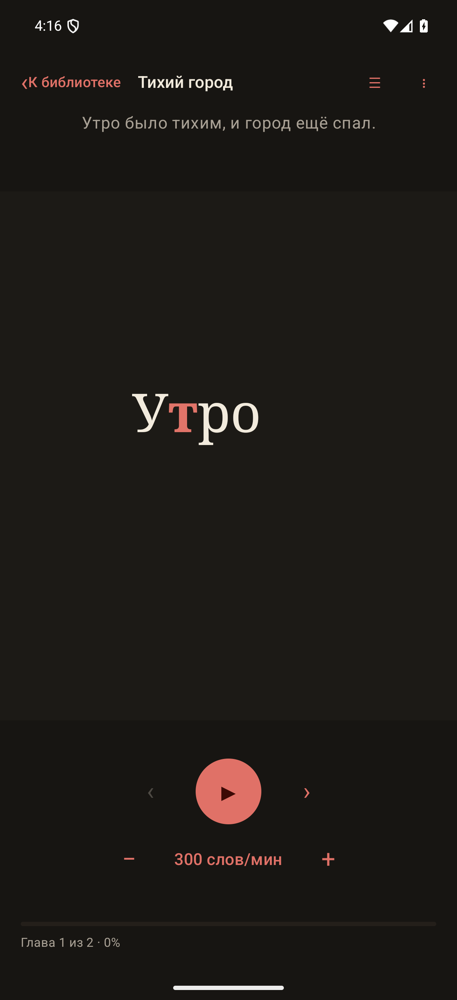

<p align="center">
  
</p>

<h1 align="center">кАдр</h1>

<p align="center">
  <strong>Офлайн-читалка FB2, которая показывает книгу по одному слову.</strong>
</p>

<p align="center">
  <code>Android 8.0+</code> ·
  <code>Kotlin</code> ·
  <code>Jetpack Compose</code> ·
  <code>Offline-first</code>
</p>

**кАдр** — локальная Android-читалка для формата FB2. Текст показывается в
режиме RSVP: в одной точке фокуса появляется по одному слову. Так можно читать,
не перемещая взгляд по строкам, и регулировать темп без потери места в книге.

Книги, обложки и прогресс остаются на устройстве. Приложение не требует
аккаунта, подключения к сети или облачной синхронизации.

[Установка](#установка) · [Возможности](#возможности) ·
[Исходники](#сборка-и-тесты) · [Приватность](#безопасность-и-приватность) ·
[Документация](#документация)

<p align="center">
  
</p>

<p align="center">
  <sub>Синтетическая демонстрационная книга. Режим паузы с фокусом на текущем слове.</sub>
</p>

## Установка

Готовый APK публикуется на странице
[Releases](https://github.com/upr1se/kadr/releases/latest).

1. Скачайте `kadr-1.0.0-release.apk` и файл `.sha256`.
2. При желании сверьте контрольную сумму по инструкции в [INSTALL.md](INSTALL.md).
3. Разрешите установку из выбранного источника и откройте APK.
4. Приложение поддерживает Android 8.0 и новее.

APK подписан и не является debug-сборкой. Ключ подписи хранится только у
автора и не входит в репозиторий.

## Возможности

- Локальная библиотека с прогрессом и продолжением чтения.
- RSVP-чтение по одному слову с неподвижной точкой фокуса.
- Скорость от 100 до 800 слов в минуту.
- Переход по предложениям и оглавлению, сноски и информация о книге.
- Восстановление позиции после сворачивания, поворота, блокировки экрана или
  смерти процесса.
- Светлая, тёмная и сепия-темы; настройка размера слова.
- Атомарный импорт `.fb2`, `.fb2.zip` и `.fbz`.
- Полностью офлайн-работа без рекламы, аналитики и сетевых SDK.

## Состояние продукта

MVP реализован: библиотека, атомарный импорт FB2/FB2.ZIP/FBZ, локальные файлы,
Room-каталог, потоковый индекс, RSVP-движок, Reader, оглавление, сноски,
настройки, темы, восстановление позиции и очистка незавершённых операций.

Версия приложения: `1.0.0`, `versionCode = 1`. Технические решения описаны в
[спецификации](TECHNICAL_SPEC_v2.0.md).

## Как это работает

Добавить книгу можно тремя способами:

1. кнопкой «Добавить книгу» в библиотеке;
2. системным «Поделиться» с одним потоком FB2;
3. открытием поддерживаемого документа из другого приложения (`ACTION_VIEW`).

Если потоков несколько, книга не импортируется и показывается сообщение.
Первая книга пустой библиотеки открывается на паузе. Последующие книги
остаются в библиотеке; snackbar «Книга добавлена» содержит действие «Открыть».

Во время воспроизведения касание экрана ставит книгу на паузу. Продолжить можно
кнопкой Play. На паузе доступны скорость 100–800 слов/мин с шагом 25,
оглавление, переходы по предложениям, сноски, информация о книге и настройки.

## Точные версии окружения

- Android Studio `2026.1.4`; JDK `25.0.3` из Android Studio JBR.
- Gradle `9.6.0`; Android Gradle Plugin `9.4.1`.
- Kotlin `2.4.21`; KSP `2.3.12`.
- Compose BOM `2026.09.00` (Compose UI `1.12.1`, Material 3 `1.4.0`).
- Navigation Compose `2.10.2`; coroutines `1.11.0`.
- Room `2.8.5`; Preferences DataStore `1.3.0`.
- kotlinx.serialization `1.12.0`.
- `minSdk = 26`, `compileSdk = 37`, `targetSdk = 37`.
- Android SDK Platform 37.0, Build Tools 37.0.0.

Версии зафиксированы в `gradle/libs.versions.toml` и
`gradle/wrapper/gradle-wrapper.properties`. Lint сообщает только о доступном
Gradle 9.8.2; обновление намеренно не выполнялось без отдельной проверки AGP.

## Сборка и тесты

```powershell
.\gradlew.bat testDebugUnitTest
.\gradlew.bat lintDebug
.\gradlew.bat assembleDebug
.\gradlew.bat connectedDebugAndroidTest
```

На Unix-подобной системе используется `./gradlew` с теми же задачами.
Требуются JDK 17 или новее, Android SDK Platform 37 и Build Tools 37.0.0.
Проект проверялся на JDK 25 и Gradle Wrapper 9.6.0.

Debug APK создаётся в `app/build/outputs/apk/debug/app-debug.apk`.
Release-ключ и параметры его подписи не публикуются. Для собственных изменений
можно создать отдельный ключ и настроить подпись в Android Studio.

## Архитектура

Один Gradle-модуль `:app`, одна `MainActivity`, Navigation Compose, MVVM + UDF,
ручной `AppContainer`, без Hilt/Koin.

- `fb2`: потоковый `XmlPullParser`, ZIP, кодировки, лимиты, канонический текст,
  токенизация, предложения, оглавление, сноски и обложка.
- `data/db`: Room через KSP; каталог, состояния, позиция и revision guard.
- `data/storage`: атомарный импорт, `manifest.json`, `book.json`, бинарный
  индекс, дедупликация, восстановление, удаление и `trash`.
- `domain/reader`: последовательность WORD/HEADING/IMAGE, точный фокус,
  длительности, планировщик, навигация, автопауза и завершение.
- `ui`: библиотека, Reader, листы, настройки и Compose-темы.

Ввод-вывод с файлами выполняется вне главного потока. Reader читает слова и
элементы из индекса случайного доступа, не загружая индекс целиком.

## Файлы книги и восстановление

В приватном `filesDir` используются:

```text
books/<bookId>/
  manifest.json
  source.fb2 | source.fb2.zip | source.fbz
  reading.txt
  reading_index.bin
  book.json
  cover.webp (необязательно)
imports/
trash/
```

Импорт сначала полностью создаётся в `imports`, затем атомарно фиксирует
`manifest.json`, переносится в `books` и только после этого появляется в Room.
При следующем запуске незавершённый импорт удаляется, а уже зафиксированный
завершается. Удаление идемпотентно через `trash`.

Если индекс или `book.json` отсутствует либо повреждён, приложение пересобирает
производные файлы из неизменённого `source`. Новое поколение проверяется и
атомарно заменяет manifest; Room синхронизируется с manifest. Незнакомые
постоянные папки автоматически не удаляются.

`reading_index.bin` содержит версию, размер и SHA-256 текста, главы, визуальные
элементы, слова, предложения, связи сносок, таблицу элементов и checksum.

## Поддерживаемый FB2

- `.fb2`, `.fb2.zip`, `.fbz`; формат определяется по содержимому.
- UTF-8 с BOM и без BOM, UTF-16 LE/BE с BOM, Windows-1251.
- Несколько основных `body`, вложенные `section`, стихи, эпиграфы, цитаты,
  таблицы, неизвестные теги с сохранением текста.
- Сноски из основного текста и `body name="notes"`.
- Обложка из `coverpage`; при ошибке используется типографическая заглушка.
- Изображения в основном тексте заменяются визуальной заглушкой.

Заголовки и визуальные элементы не увеличивают количество слов. Длинные токены
делятся по grapheme boundaries на сегменты не длиннее 96 графем. Для CJK и
других языков без пробелов корректная лингвистическая разбивка не обещается:
абзац может стать одним длинным токеном.

Импорт ограничен 50 MiB исходника, 250 MiB распакованного ZIP, 5 млн слов и
другими именованными лимитами XML/текста/сносок/обложки. `DOCTYPE`, сущности,
XXE, ZIP traversal и ZIP bomb отклоняются.

## Безопасность и приватность

- Нет разрешения `INTERNET` и широкого доступа к файлам.
- Временный доступ к выбранному документу не сохраняется; приложение сразу
  копирует поток в приватное хранилище.
- `allowBackup=false`; cloud backup и device-to-device transfer исключены.
- Экспортирован только `MainActivity`; debug-activity Compose-тестов имеет
  `exported=false`. Room service также не экспортируется.
- Нет аккаунтов, аналитики, crash reporting, TTS, облака и сетевых переходов.
- Логи не содержат текст книги, внутренние пути или полные URI.
- Сноски показываются только как текст; URL не открываются.

## Проверенные сценарии

На окончательной сборке выполнены:

- 76 JVM-тестов: парсер, кодировки, ZIP-атаки, токенизация, фокус, таймер,
  предложения, главы, хранение, дедупликация, восстановление, Room-логика и
  контраст тем.
- 18 instrumented-тестов на API 26 и API 37: Room, импортные intent-правила,
  Library, Reader, панели, ChapterBreak, Completed, Error, настройки, 200%
  системный шрифт и длинное слово.
- `testDebugUnitTest`, `lintDebug`, `assembleDebug`: успешно; lint — 0 errors.
- Установка и запуск на Android 8.0 / API 26 и Android 17 / API 37: PASS.
- API 37: подтверждён render rate `120.00001 Hz`.
- Синтетическая книга с 1 000 000 слов: разбор и индекс на JVM за 3,4 с;
  импорт и открытие на API 37 без OOM.
- 750 слов/мин: непрерывный двухминутный прогон, 1616 слов, экран оставался
  отзывчивым; отсутствие пропусков дополнительно проверено 10-минутным
  виртуальным тестом.
- Смерть процесса: Reader восстановлен на паузе на том же слове, с той же
  скоростью и маршрутом.
- Потеря фокуса окна/системная панель, сворачивание, блокировка и включение
  экрана, поворот и возврат: чтение останавливается, позиция сохраняется,
  автозапуск не происходит.
- Портрет, ландшафт, 200% шрифта, длинный токен, три темы и листы проверены
  визуально на эмуляторе.
- Release APK проверен Microsoft Defender без обнаруженных угроз.

## Известные ограничения

- Только FB2 и его ZIP-контейнеры; EPUB, PDF, MOBI и DOCX не поддерживаются.
- Нет поиска, заметок, закладок, статистики, экспорта и синхронизации.
- Нет полноценного TalkBack-режима для быстро меняющегося потока слов.
- Нет TTS, фонового воспроизведения, виджетов и Wear OS.
- Иллюстрации показываются заглушкой; сложные таблицы линеаризуются.
- Для текста без пробелов (например, CJK) разбивка на слова ограничена.
- Android Backup и перенос данных отключены намеренно.
- Репозиторий не содержит книг. Импортируйте только законно полученные файлы.

## Документация

- [Установка и проверка APK](INSTALL.md)
- [Политика безопасности и сообщение об уязвимостях](SECURITY.md)
- [Приватность и локальные данные](PRIVACY.md)
- [Как принять участие](CONTRIBUTING.md)
- [Техническая спецификация](TECHNICAL_SPEC_v2.0.md)
- [Исходный файл иконки](artwork/ic_launcher_master.png)

Отображаемое название приложения — **кАдр**. Технический
`applicationId` — `com.upr1se.kadr`.

## Лицензия

Исходный код, документация и оригинальная иконка распространяются по лицензии
[MIT](LICENSE).
